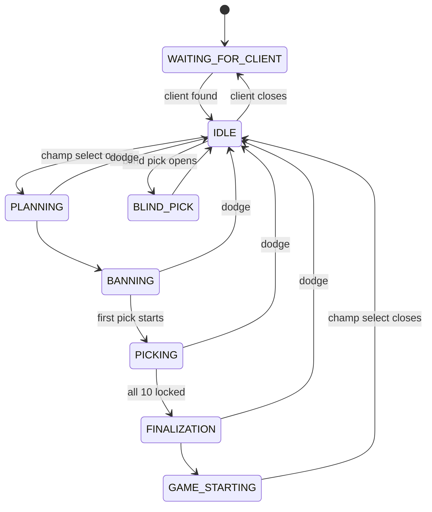

# Program phases

The app is always in exactly one phase. The phase is shown in the status bar and
every change is logged (`phase: BANNING -> PICKING`). The phases are defined in
[`phases.py`](../src/leaguephd_shell/phases.py), and only one method changes them:
`DraftController._set_phase` in [`controller.py`](../src/leaguephd_shell/controller.py).
The controller holds all the draft logic and has no Qt in it; the window only
forwards events to it and carries out its requests.

The League client decides the phase; the app reads it. Connection phases
come from the LCU loop, and champ select phases come from each session snapshot.



Not drawn: any phase can go to `WAITING_FOR_CLIENT` if the client closes, and
connecting mid-draft goes straight from `IDLE` to whichever phase the draft is in.

## The phases

| Phase | Entered when | What the app does | Pick-now page |
|---|---|---|---|
| `WAITING_FOR_CLIENT` | Startup, or the client closes | Looks for `LeagueClientUx.exe` every 2 s | Loaded, idle |
| `IDLE` | Credentials found and the API answers | Polls the champ select session every 0.5 s (404 = not in champ select) | Idle |
| `PLANNING` | Champ select opens (`timer.phase = PLANNING`) | Reloads the page for a clean draft and resets the tracker. Sends your side. | `pick_side` → `ban` |
| `BANNING` | `BAN_PICK` with no pick started | Sends `bans` as they lock (`updated.mode = "ban"`) | `ban`: shows ban portraits |
| `PICKING` | `BAN_PICK` and a pick is completed or in progress | First update sets `to_pick_phase`. Every lock-in adds to `insert_list` with side, slot and (for allies) role. | `pick`: suggestion table |
| `FINALIZATION` | `timer.phase = FINALIZATION` | Nothing new to send; the tracker goes inactive after the 10th pick | Final suggestions stay up |
| `GAME_STARTING` | `timer.phase = GAME_STARTING` | Nothing | Unchanged |
| `BLIND_PICK` | `hasSimultaneousPicks` is true | Ignores the session; there's no draft to analyse | Unchanged |

`timer.phase` is the client's own field. It has one `BAN_PICK` phase for both bans
and picks, so the app splits it by whether any pick action has started.

## Where each phase lives in the code

| Concern | Code |
|---|---|
| Finding and connecting to the client (`WAITING_FOR_CLIENT`, `IDLE`) | `lcu.run_forever`, `lcu.find_credentials` |
| Receiving session snapshots (websocket, or HTTP polling fallback) | `lcu.champ_select_events`, `lcu._poll`, `lcu.diff_sessions` |
| Naming the champ select phase from a snapshot | `Phase.from_session` |
| Changing phase (log, then status bar via `on_phase`) | `DraftController._set_phase` |
| Deciding when a draft starts fresh (reset + reload) | `DraftController.session_event`, `_start_fresh_page` |
| Turning snapshots into page updates | `ChampSelect.update`, `ChampSelect.payload` |
| Queueing updates until the page is ready | `DraftController._send`, `page_load_started`, `page_ready` |
| Qt side: loading the page, running `app_call`, probing readiness | `MainWindow` in `window.py` (the controller's `PageDriver`) |

## Edge cases

- **Dodge or requeue.** Champ select closes, which is a `Delete` and goes to `IDLE`.
  When polling, a new `gameId` with no 404 in between also counts as a new draft
  (`Create`), so the page reloads.
- **Connecting mid-draft.** The first thing the app does after connecting is
  fetch the current session, so it jumps straight to the right phase. The
  tracker rebuilds the whole draft from that one snapshot.
- **Client restart.** The poll or websocket fails, so the phase goes to
  `WAITING_FOR_CLIENT` and the app reconnects when the client is back. The
  `IDLE` reported on reconnect never overwrites a champ select phase.
- **Browsing away mid-draft.** If you navigate off pick-now during a draft, the
  next update reloads pick-now and replays the draft from the snapshot.
- **Page not loaded yet.** Updates queue up until the page's `app_call` exists,
  then they're sent in order.
- **A late "ready" from the previous page.** Each page load gets a token. If a
  new draft reloads the page while the old page's readiness check is still in
  flight, that check's answer carries an old token and is ignored, so queued
  updates never go to a page that's being replaced.

## Verified against a real draft

Replaying a recorded ranked draft (`--debug` writes `logs/session.jsonl`) through
`Phase.from_session` gives:

```
event   0: None -> PLANNING
event   6: PLANNING -> BANNING
event  23: BANNING -> PICKING
event  76: PICKING -> FINALIZATION
event  90: FINALIZATION -> GAME_STARTING
event  91: GAME_STARTING -> IDLE
```
